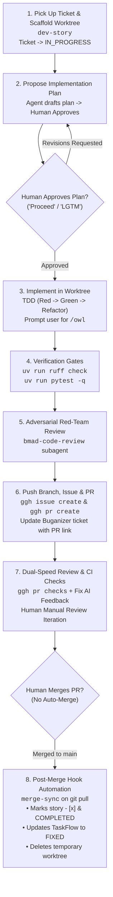

# Story Development Skill (`dev-story`)

Use this skill when beginning implementation on any story in `docs/bmad/stories/story-*.md`.

---

## 🔄 The 7-Step Development Protocol



---

### Step 1: Pre-Flight Readiness & Worktree Setup
- **Dependency Gate**: Inspect story frontmatter `depends_on`. Ensure all prerequisite stories are `COMPLETED` before proceeding.
- **Execution Mode Check**: Note `execution_mode: "AFK"` (autonomous) vs `execution_mode: "HUMAN_MONITORED"` (critical oversight required).
- Run the scaffolding tool:
  ```bash
  python3 scripts/dev_story.py --story docs/bmad/stories/<story-file>.md --setup-worktree
  ```
- Creates `../<repo>-<story-slug>` branching from `origin/main`.
- Symlinks `.venv`, `node_modules`, `data`, and `.env` instantly without copying heavy files.
- Updates Buganizer ticket status to `ASSIGNED` (`IN_PROGRESS`).

### Step 2: Propose Implementation Plan (Prompt for `/grill-me`)
- Read story specification, acceptance criteria, and dependency context.
- Formulate a clear step-by-step implementation plan (target files, architectural seams, verification tests).
- **Prompt the Developer with Recommended Action**:
  > 💡 **Recommended Next Step**: If you would like to stress-test this plan, challenge assumptions, and resolve open questions through an interactive interview before code is modified, type `/grill-me`. When ready to begin, reply **`Proceed`** or **`LGTM`**.
- **Hard Gate**: Wait for explicit human approval before modifying code.

### Step 3: Worktree Implementation (Prompt for `/owl` & TDD)
- **Prompt the Developer for Autonomous Deep Execution**:
  > 💡 **Recommended Next Step**: For deep autonomous execution with multi-perspective planning and structured TDD checkpoints, type `/owl` (or `/goal`) to launch the unattended implementation session.
- **Mandatory Test-Driven Development (TDD) Protocol**:
  1. **🔴 Red (Test-First)**: Pull in `write-python` or `write-typescript`. Author unit/integration tests in `tests/test_*.py` asserting the exact acceptance criteria. Run `uv run pytest -q tests/test_<feature>.py` to verify the tests fail for the right reasons.
  2. **🟢 Green (Implement Minimal Code)**: Author the production code in `src/` to satisfy the tests. Run `uv run pytest -q` until all tests pass cleanly.
  3. **🔵 Refactor & Harden**: Refactor implementation for clarity, performance, and strict typing while keeping tests green.

### Step 4: Hard Verification Gates
Execute all verification gates in the worktree:
```bash
uv run ruff check src tests scripts
uv run pytest -q
cd web && npx tsc --noEmit   # If frontend touched
```

### Step 5: Adversarial Red-Team Review (Subagent)
- The agent spawns an in-session subagent running `bmad-code-review` to inspect the `git diff` against language standards, edge cases, and memory leaks.
- Fix any identified blocker findings in the worktree before proceeding.

### Step 6: GitHub Issue & PR Submission
Push branch and submit via `ggh`:
```bash
git push -u origin feat/<story-slug>
ggh issue create --title "[<PREFIX>] <Story Title>" --body "<In-Repo Path, TaskFlow Link, AC Checklist>"
ggh pr create --base main --head feat/<story-slug> --title "[<PREFIX>] <Story Title>" --body "<Summary, Issue #, Verification Proofs>"
```
Update Buganizer ticket `b/<id>` with Issue and PR links.

### Step 7: Dual-Speed Review & Post-Merge Sync
- Check CI/AI review feedback: `ggh pr checks`.
- Resolve any findings on branch and push fixes.
- Developer performs final review and manually merges PR.
- Run post-merge sync on `main`:
  ```bash
  git checkout main && git pull origin main
  ```
  *(Or execute `python3 scripts/merge_sync.py`)* to mark story `- [x]`, update TaskFlow to `FIXED`, and delete the worktree.
