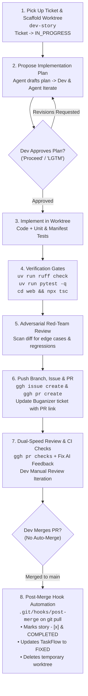

# Orbweaver Story Development Skill (`dev-story`)

Use this skill when beginning implementation on any story in `docs/bmad/stories/story-*.md`.

---

## 🔄 The 7-Step Development Protocol



---

### Step 1: Pre-Flight Readiness & Worktree Setup
Run the scaffolding tool:
```bash
python3 scripts/dev_story.py --story docs/bmad/stories/<story-file>.md --setup-worktree
```
- Creates `../orbweaver-<story-slug>` branching from `origin/main`.
- Symlinks `.venv`, `node_modules`, `data`, and `.env` instantly without copying heavy files.
- Updates Buganizer ticket status to `ASSIGNED` (`IN_PROGRESS`).

### Step 2: Propose Implementation Plan (Wait for Approval)
- Read story specification and acceptance criteria.
- Formulate a clear step-by-step implementation plan (target files, architectural seams, verification tests).
- **Hard Gate**: Present the plan to the developer and wait for explicit approval before modifying code.

### Step 3: Worktree Implementation
- Navigate to `../orbweaver-<story-slug>`.
- Implement changes following codebase idioms.
- Add unit/integration tests covering acceptance criteria.

### Step 4: Verification Gates
Execute all verification gates in the worktree:
```bash
uv run ruff check src tests scripts
uv run pytest -q
cd web && npx tsc --noEmit   # If frontend touched
```

### Step 5: Adversarial Red-Team Review
Scan git diff against edge cases, resource exhaustion, queue thrashing, and boundary failures.

### Step 6: GitHub Issue & PR Submission
Push branch and submit via `ggh`:
```bash
git push -u origin feat/<story-slug>
ggh issue create --title "[TO1] <Story Title>" --body "<In-Repo Path, TaskFlow Link, AC Checklist>"
ggh pr create --base main --head feat/<story-slug> --title "[TO1] <Story Title>" --body "<Summary, Issue #, Verification Proofs>"
```
Update Buganizer ticket `b/<id>` with Issue and PR links.

### Step 7: Dual-Speed Review & Post-Merge Hook
- Check CI/AI review feedback: `ggh pr checks`.
- Resolve any findings on branch and push fixes.
- Developer performs final review and manually merges PR.
- Developer runs `git checkout main && git pull origin main`:
  - Triggers `.git/hooks/post-merge` to mark story `- [x]`, update TaskFlow to `FIXED`, and delete worktree.
