# AGENTS.md — The GoldThread AI-Native Operating Manual

This document defines the operating rules, verification standards, and lifecycle protocols for AI coding assistants (Gemini, Jetski, Claude) and software engineers pair-programming on **GoldThread / TPUbench**.

---

## 🏛️ Core Invariants

1. **In-Repo Single Source of Truth**: All requirements (`docs/bmad/planning/prd.md`), architecture designs (`docs/bmad/planning/architecture.md`), and sharded story contracts (`docs/bmad/stories/`) live in the Git repository.
2. **Workspace Isolation**: **No feature development or code changes occur directly on `main`**. Every story, feature, or bug fix is implemented inside an isolated Git worktree (`../goldthread-<story>`).
3. **Collaborative Planning Gate**: The agent proposes a step-by-step implementation plan and **MUST wait for explicit human approval** before modifying code.
4. **Hard Verification Gates**: Every change must satisfy automated linting (`uv run ruff check src tests scripts`) and unit tests (`uv run pytest -q`) before submission.
5. **Adversarial Red-Team Review**: The agent conducts a cynical edge-case review on the `git diff` before opening a Pull Request.
6. **Live Cloud Synchronization**: In-repo specs automatically synchronize with Google TaskFlow (Workspace 6001488), Buganizer, and GitHub without manual form-filling.
7. **Strict Human Merge Gate**: Humans review and manually merge Pull Requests. Merging triggers automated post-merge synchronization and worktree cleanup via `merge-sync`.

---

## 🔄 The Canonical 7-Step AI-Native Dev Loop

```mermaid
graph TD
    classDef step fill:#e8f0fe,stroke:#1a73e8,stroke-width:2px,color:#1a73e8;
    classDef gate fill:#fef7e0,stroke:#f9ab00,stroke-width:2px,color:#b06000;
    classDef human fill:#fce8e6,stroke:#d93025,stroke-width:2px,color:#d93025;
    classDef hook fill:#e6f4ea,stroke:#137333,stroke-width:2px,color:#137333;

    S1["1. Pick Up Ticket & Scaffold Worktree<br/><code>dev-story</code> / <code>scripts/dev_story.py</code><br/>Ticket -> IN_PROGRESS"]:::step --> S2["2. Collaborative Planning<br/>Agent proposes plan -> Human & Agent Iterate"]:::step
    S2 --> G1{"Human Approves Plan?<br/>('Proceed' / 'LGTM')"}:::human
    G1 -->|Approved| S3["3. Implement in Worktree<br/>Code + Unit & Integration Tests"]:::step
    G1 -->|Revisions Requested| S2

    S3 --> G2["4. Verification Gates<br/><code>uv run ruff check</code><br/><code>uv run pytest -q</code>"]:::gate
    G2 --> S4["5. Adversarial Red-Team Review<br/>Scan diff for numerical stability & edge cases"]:::step
    S4 --> S5["6. Push Branch, Issue & PR<br/><code>ggh issue create</code> & <code>ggh pr create</code><br/>Update Buganizer ticket with PR link"]:::step

    S5 --> S6["7. Dual-Speed Review & CI Checks<br/><code>ggh pr checks</code> + Fix AI Feedback<br/>Human Manual Review Iteration"]:::human
    S6 --> G3{"Human Merges PR?<br/>(No Auto-Merge)"}:::human

    G3 -->|Merged to main| H1["8. Post-Merge Synchronization<br/><code>merge-sync</code> / <code>post-merge</code> hook<br/>• Marks story - [x] & COMPLETED<br/>• Updates TaskFlow to FIXED<br/>• Deletes temporary worktree"]:::hook
```



---

### Step-by-Step Execution Guide:

### Step 1: Pick Up Ticket & Scaffold Worktree (`dev-story` skill)
Developer selects a story from [TaskFlow GoldThread (Workspace 6001488)](https://taskflow.corp.google.com/workspaces/6001488/goals):
```bash
python3 scripts/dev_story.py --story docs/bmad/stories/<story-file>.md --setup-worktree
```
- Creates `../goldthread-<story-slug>` branching from `origin/main`.
- Zero-copy symlinks dependencies (`.venv`, `data`, `.env`).
- Automatically transitions TaskFlow / Buganizer ticket to `IN_PROGRESS` (`ASSIGNED`).

### Step 2: Collaborative Planning & Interactive Alignment (Human Gate)
- The agent reads the story specification and proposes a granular step-by-step implementation plan.
- The developer and agent iterate on telemetry parsing, radiometric calibration algorithms, or GKE orchestration.
- **Hard Gate**: Code modification **NEVER** begins until the developer explicitly approves the plan.

### Step 3: Worktree Implementation (Test-Driven Development & `/owl` Mode)
- **Deep Execution with `/owl`**: For self-contained stories without external repository dependencies (especially in `execution_mode: "AFK"`), leverage the `/owl` slash command for multi-perspective planning, systematic TDD checkpointing, and rigorous self-verification.
- **Mandatory Test-Driven Development (TDD) Protocol**:
  1. **🔴 Red (Test-First)**: Author unit/integration tests directly in `tests/test_*.py` asserting telemetry decoding, radiometric calibration accuracy, or JAX kernel coherence before modifying production code. Run `uv run pytest -q tests/test_<feature>.py` to verify tests fail for the right reasons.
  2. **🟢 Green (Implement Minimal Code)**: Author the minimal signal processing logic in `src/` to satisfy the tests. Run `uv run pytest -q` until all tests pass cleanly.
  3. **🔵 Refactor & Harden**: Refactor for numerical stability, JAX JIT purity, and memory efficiency while keeping tests green.
- All modifications remain strictly isolated in `../goldthread-<story-slug>`.

### Step 4: Hard Verification Gates (Definition of Done)
Run verification commands and inspect real outputs:
- `uv run ruff check src tests scripts` → **Clean (0 errors)**.
- `uv run pytest -q` → **All green**.
- **Verify live against real telemetry/MODIS data** when touching radiometric or decompression pipelines.

### Step 5: Adversarial BMAD Red-Team Review
- The agent scans the `git diff` for:
  - Big-endian bitfield unpacking overflow or boundary misalignment.
  - Floating-point overflow / division by zero in Planck inversion ($c_1 / (\lambda^5 (\exp(c_2/\lambda T) - 1))$).
  - Memory leaks in high-throughput satellite swath rendering.
- Surfaced issues are fixed on the branch before opening the PR.

### Step 6: PR Submission & Tracker Linking
- Push branch: `git push -u origin feat/<story-slug>`.
- Open GitHub Issue and Pull Request using `ggh`:
  ```bash
  ggh issue create --title "[GOLDTHREAD] <Story Title>" --body "<Story Path, TaskFlow Link, AC Checklist>"
  ggh pr create --base main --head feat/<story-slug> --title "[GOLDTHREAD] <Story Title>" --body "<Summary, Issue #, Verification Proofs>"
  ```
- Post update comment to TaskFlow / Buganizer ticket (`b/<id>`) linking PR and Issue URLs.

### Step 7: Dual-Speed Review, Human Iteration & Manual Merge
- Inspect CI/CD and AI PR reviewer feedback: `ggh pr checks`.
- Resolve any reviewer comments and push fixes.
- Human conducts final review and iterates until satisfied.
- **Strict Human Merge Gate**: Developer manually clicks Merge on the PR.

### Step 8: Post-Merge Hook & Local Synchronization (`merge-sync` skill)
- Once merged, the developer triggers `merge-sync` or runs `git pull origin main`:
  ```bash
  python3 scripts/merge_sync.py
  ```
- Automatically marks story `- [x]`, updates TaskFlow ticket to `FIXED`, deletes the temporary worktree, and syncs frontmatter.

---

## 📋 Story Specification Standards (Dependencies & Execution Modes)

When drafting or creating user stories (in `docs/bmad/stories/` and `docs/bmad/planning/epics.md`), every story MUST explicitly specify:

1. **Explicit Story Dependencies (`depends_on`)**:
   - Declare all upstream prerequisite stories in the YAML frontmatter and markdown body:
     ```yaml
     depends_on: ["story-modis-1.1", "story-modis-1.2"]  # list of prerequisite story slugs
     ```
   - If the story has no prerequisites and is ready to pick up immediately: `depends_on: []`.
   - **Pre-Flight Dependency Gate**: Before picking up a story in Step 1, verify that all declared `depends_on` stories are marked `stage: "COMPLETED"` (or `- [x]`). Do not scaffold worktrees for blocked stories out of order.

2. **Operational Execution Mode (`execution_mode`)**:
   - Declare whether the story can be executed autonomously by an agent in unattended (AFK) mode or requires active developer supervision:
     - `execution_mode: "AFK"` (Autonomous):
       - *Criteria*: Self-contained scope, deterministic contracts, high unit-test coverage, low architectural blast radius, no destructive DB migrations or unbounded external spend.
       - *Agent Behavior*: Once the human approves the plan (Step 2), the agent can execute Step 3 (implementation), Step 4 (verification gates), Step 5 (red-team review), and Step 6 (PR creation) in autonomous unattended mode.
     - `execution_mode: "HUMAN_MONITORED"` (Critical / Supervised):
       - *Criteria*: Involves high-risk architectural refactoring, destructive database schema migrations, external billable API spend / quota usage (e.g. Gemini Vertex VLM calls), security/auth trust boundaries, or complex frontend/UX alterations.
       - *Requirement*: Must document an explicit `human_monitoring_rationale` explaining why developer presence is required during worktree execution.

3. **Vertical Slice Architecture Principle (Tracer Bullets vs. Horizontal Layers)**:
   - **Strict Anti-Pattern — No Horizontal Layering**: Never decompose stories by architectural tier (e.g., Story 1 = Telemetry unpack only, Story 2 = Calibration math only, Story 3 = GCS pipeline only).
   - **Mandatory Vertical Slices**: Every story MUST cut vertically through the stack to deliver a functional, testable end-to-end flow:
     - **Story 1 (Walking Skeleton / Tracer Bullet)**: Builds the minimal end-to-end path through the entire pipeline (e.g., Raw Data $\to$ Core Reconstruction Algorithm $\to$ Calibrated Output $\to$ E2E Integration/Coherence Test). Must be runnable and measurable from Day 1.
     - **Subsequent Stories (Progressive Enrichment)**: Add incremental depth, additional spectral bands, hardware acceleration (JAX Cloud TPU kernels), and distributed batch orchestration.
     - **Continuous Verifiability**: Every single story must include an end-to-end integration test or benchmark command (`uv run pytest -q`) proving the complete pipeline works with that story's additions.
