# AGENTS.md — The AI-Native Operating Manual

> **Last Updated:** 2026-08-17  
> **Status:** Active Dev Guidance

This document defines the operating rules, verification standards, and lifecycle protocols for AI coding assistants (Gemini, Jetski, Claude) and software engineers pair-programming in this repository.

---

## 🏛️ Core Principles

1. **In-Repo Single Source of Truth**: Requirements (`docs/bmad/planning/prd.md`), architecture designs (`docs/bmad/planning/architecture.md`), and sharded story contracts (`docs/bmad/stories/`) live in the Git repository.
2. **Workspace Isolation**: **No feature development or code changes occur directly on `main`**. Every story, feature, or bug fix is implemented inside an isolated Git worktree (`../<repo>-<story>`).
3. **Collaborative Planning Gate**: The agent proposes a step-by-step implementation plan and **MUST wait for explicit human approval** before modifying code.
4. **Hard Verification Gates**: Every change must satisfy automated linting, unit tests, and type checks before submission. Passing tests are mandatory.
5. **Adversarial Red-Team Review**: The agent conducts a cynical edge-case review on the `git diff` before opening a Pull Request.
6. **Human-Confirmed Cloud Synchronization**: In-repo specs synchronize with Google TaskFlow and Buganizer ONLY after explicit human review and confirmation during the planning phase.
7. **Human-Authorized Merge 7. **Strict Human Merge Gate**: Humans review and manually merge Pull Requests. Merging triggers automated post-merge synchronization and worktree cleanup. Sync**: Manually triggering `merge-sync` (or `scripts/merge_sync.py`) serves as explicit human approval to merge open PRs, pull main, transition tickets to FIXED, and clean worktrees.
8. **Documentation Freshness & Lifecycle Metadata**: Every document maintained under `docs/` MUST declare its Last Updated Date and status badge at the top (`> **Last Updated:** YYYY-MM-DD\n> **Status:** Active Reference | Draft | Stale | Archived`). Agents and humans must update this timestamp whenever modifying architectural, PRD, or workflow documents.
9. **Session Freshness & Anti-Context-Bloat Rule**: To prevent reasoning degradation, hallucinations, and "dumb decisions" caused by massive prompt histories, maintain strict **separation across 3 agent roles**: Planning Session $\to$ Fresh Dev Session per Story $\to$ Autonomous GitHub Actions PR Reviewer. Never implement multiple stories in one conversation session.
10. **Deep Modules & Interface-Centric Design (Where Applicable)**: When designing software components and writing code, modules and classes should be **deep** (simple, intuitive public interface hiding substantial internal complexity). Tests should exercise and assert behavior through this public interface rather than private plumbing. This is a foundational software design philosophy applied where appropriate—not a dogmatic constraint for infrastructure, documentation, or configuration stories.


---

## 🔄 The Canonical 7-Step AI-Native Dev Loop

```mermaid
graph TD
    classDef step fill:#e8f0fe,stroke:#1a73e8,stroke-width:2px,color:#1a73e8;
    classDef gate fill:#fef7e0,stroke:#f9ab00,stroke-width:2px,color:#b06000;
    classDef human fill:#fce8e6,stroke:#d93025,stroke-width:2px,color:#d93025;
    classDef hook fill:#e6f4ea,stroke:#137333,stroke-width:2px,color:#137333;

    S1["1. Pick Up Ticket & Scaffold Worktree<br/><code>dev-story</code> / <code>scripts/dev_story.py</code><br/>Ticket -> IN_PROGRESS"]:::step --> S2["2. Collaborative Planning<br/>Agent proposes plan -> Human & Agent Iterate"]:::step
    S2 --> G1{"Human Approves Plan?<br/>('Proceed' / 'LGTM')"}:::human
    G1 -->|Approved| S3["3. Implement in Worktree<br/>Code + Unit & Integration Tests"]:::step
    G1 -->|Revisions Requested| S2

    S3 --> G2["4. Verification Gates<br/>Linting & Tests"]:::gate
    G2 --> S4["5. Adversarial Red-Team Review<br/>Scan diff for edge cases & regressions"]:::step
    S4 --> S5["6. Push Branch, Issue & PR<br/><code>ggh issue create</code> & <code>ggh pr create</code><br/>Update Buganizer ticket with PR link"]:::step

    S5 --> S6["7. Dual-Speed Review & CI Checks<br/><code>ggh pr checks</code> + Fix AI Feedback<br/>Human Manual Review Iteration"]:::human
    S6 --> G3{"Human Merges PR?<br/>(No Auto-Merge)"}:::human

    G3 -->|Merged to main| H1["8. Post-Merge Synchronization<br/><code>merge-sync</code> / <code>post-merge</code> hook<br/>• Marks story - [x] & COMPLETED<br/>• Updates TaskFlow to FIXED<br/>• Deletes temporary worktree"]:::hook
```



---

### Step-by-Step Execution Guide:

### Step 1: Pick Up Ticket & Scaffold Worktree (`dev-story` skill)
Developer selects a story from the backlog and initializes the isolated environment:
```bash
python3 scripts/dev_story.py --story docs/bmad/stories/<story-file>.md --setup-worktree
```
- Creates `../<repo>-<story-slug>` branching from `origin/main`.
- Zero-copy symlinks dependencies (`.venv`, `node_modules`, `.env`).
- Automatically transitions TaskFlow / Buganizer ticket to `IN_PROGRESS` (`ASSIGNED`).

### Step 2: Collaborative Planning & Socratic Alignment (`/grill-me` Gate)
- The agent reads the story specification and proposes a granular step-by-step implementation plan.
- **Socratic Grilling (`/grill-me`)**: For complex stories or architectural alterations, developer and agent leverage the `/grill-me` skill to stress-test requirements, boundary edge cases, backward-compatibility, and verification strategies before writing code.
- The developer and agent iterate to resolve any open questions or adjust requirements.
- **Hard Gate**: Code modification **NEVER** begins until the developer explicitly approves the plan.

### Step 3: Worktree Implementation (Test-Driven Development & `/owl` Mode)
- **Deep Execution with `/owl`**: For self-contained stories without external repository dependencies (especially in `execution_mode: "AFK"`), leverage the `/owl` slash command for multi-perspective planning, systematic TDD checkpointing, and rigorous self-verification.
- **Mandatory Test-Driven Development (TDD) Protocol**:
  1. **🔴 Red (Test-First)**: Author unit/integration tests directly in `tests/test_*.py` asserting the story's Acceptance Criteria and data contracts before modifying production code. Run `uv run pytest -q tests/test_<feature>.py` to verify the tests fail for the right reason.
  2. **🟢 Green (Implement Minimal Code)**: Implement the minimal production logic in `src/` required to satisfy the tests. Run `uv run pytest -q` until all tests pass cleanly.
  3. **🔵 Refactor & Harden**: Refactor implementation for clarity, performance, and strict typing while keeping tests green.

### Step 4: Hard Verification Gates (Definition of Done)
Run verification commands and inspect real outputs:
- Backend: `uv run ruff check src tests scripts` && `uv run pytest -q`
- Frontend: `cd web && npx tsc --noEmit`
- Live Path: Verify against real endpoints / data when runtime paths are touched.

### Step 5: Adversarial BMAD Red-Team Review
- The agent scans the `git diff` for:
  - Unhandled boundary conditions and exceptions.
  - Resource leaks (memory, database connections, unclosed handles).
  - Race conditions, queue thrashing, or performance bottlenecks.
- Surfaced issues are fixed on the branch before opening the PR.

### Step 6: PR Submission & Tracker Linking
- Push branch: `git push -u origin feat/<story-slug>`.
- Open GitHub Issue and Pull Request:
  ```bash
  ggh issue create --title "[<PREFIX>] <Story Title>" --body "<Story Path, TaskFlow Link, AC Checklist>"
  ggh pr create --base main --head feat/<story-slug> --title "[<PREFIX>] <Story Title>" --body "<Summary, Issue #, Verification Proofs>"
  ```
- Post update comment to TaskFlow / Buganizer ticket (`b/<id>`) linking PR and Issue URLs.

### Step 7: Dual-Speed Review, Human Iteration & Manual Merge
- Inspect CI/CD and AI PR reviewer feedback: `ggh pr checks`.
- Resolve any reviewer comments and push fixes.
- Human conducts final review and iterates until satisfied.
- **Strict Human Merge Gate**: Developer manually clicks Merge on the PR.

### Step 8: Post-Merge Hook & Local Synchronization (`merge-sync` skill)
- Once merged, the developer triggers `merge-sync` or runs `git pull origin main`:
  ```bash
  python3 scripts/merge_sync.py
  ```
- Automatically marks story `- [x]`, updates TaskFlow ticket to `FIXED`, deletes the temporary worktree, and syncs frontmatter.

---

## 📋 Story Specification Standards (Dependencies & Execution Modes)

When drafting or creating user stories (in `docs/bmad/stories/` and `docs/bmad/planning/epics.md`), every story MUST explicitly specify:

1. **Explicit Story Dependencies (`depends_on`)**:
   - Declare all upstream prerequisite stories in the YAML frontmatter and markdown body:
     ```yaml
     depends_on: ["story-1.1", "story-1.2"]  # list of prerequisite story slugs
     ```
   - If the story has no prerequisites and is ready to pick up immediately: `depends_on: []`.
   - **Pre-Flight Dependency Gate**: Before picking up a story in Step 1, verify that all declared `depends_on` stories are marked `stage: "COMPLETED"` (or `- [x]`). Do not scaffold worktrees for blocked stories out of order.

2. **Operational Execution Mode (`execution_mode`)**:
   - Declare whether the story can be executed autonomously by an agent in unattended (AFK) mode or requires active developer supervision:
     - `execution_mode: "AFK"` (Autonomous):
       - *Criteria*: Self-contained scope, deterministic contracts, high unit-test coverage, low architectural blast radius, no destructive DB migrations or unbounded external spend.
       - *Agent Behavior*: Once the human approves the plan (Step 2), the agent can execute Step 3 (implementation), Step 4 (verification gates), Step 5 (red-team review), and Step 6 (PR creation) in autonomous unattended mode.
     - `execution_mode: "HUMAN_MONITORED"` (Critical / Supervised):
       - *Criteria*: Involves high-risk architectural refactoring, destructive database schema migrations, external billable API spend / quota usage (e.g. Gemini Vertex VLM calls), security/auth trust boundaries, or complex frontend/UX alterations.
       - *Requirement*: Must document an explicit `human_monitoring_rationale` explaining why developer presence is required during worktree execution.

3. **Vertical Slice Architecture Principle (Tracer Bullets vs. Horizontal Layers)**:
   - **Strict Anti-Pattern — No Horizontal Layering**: Never decompose stories by architectural tier (e.g., Story 1 = DB schema only, Story 2 = detector only, Story 3 = triage only, Story 4 = UI only, where nothing is testable end-to-end until the final story).
   - **Mandatory Vertical Slices**: Every story MUST cut vertically through the stack to deliver a functional, testable end-to-end flow:
     - **Story 1 (Walking Skeleton / Tracer Bullet)**: Builds the minimal end-to-end path through the entire pipeline (e.g., Input Data $\to$ Primary Processing Branch $\to$ Core Business Logic $\to$ Persistence/Output $\to$ E2E Integration/Benchmark Test). Must be runnable and measurable from Day 1.
     - **Subsequent Stories (Progressive Enrichment)**: Add incremental depth, additional algorithmic branches, deep reasoning tiers, advanced caching, interactive UI views, and edge-case handling.
     - **Continuous Verifiability**: Every single story must include an end-to-end integration test or benchmark command (e.g. `uv run pytest -q tests/test_e2e_*.py`) proving the complete pipeline works with that story's additions.

---

## 📅 Documentation Freshness & Lifecycle Metadata Standards

To ensure agents and engineers never build against outdated requirements, all documentation under `docs/` (planning, PRDs, architecture, workflows, and specifications) MUST include a standardized metadata block directly beneath the H1 title:

```markdown
> **Last Updated:** YYYY-MM-DD  
> **Status:** Active Reference  # Options: Active Reference | In-Review | Draft | Stale | Archived
```

### Lifecycle Rules:
1. **Mandatory Date Stamping**: Whenever an agent or engineer updates an architectural diagram, requirements list, or workflow guide, they **MUST** update the `Last Updated` date to the current date.
2. **Status Definitions**:
   - `Active Reference`: The authoritative, live source of truth for the codebase.
   - `In-Review`: Proposed changes currently under human or peer review.
   - `Draft`: Brainstorming or initial architectural framing in progress.
   - `Stale`: Superseded or unverified documentation requiring re-validation.
   - `Archived`: Historical reference preserved for retrospective context.

---

## 🔤 Modular Language Coding Standards (Skills-Based Architecture)

Rather than rigid monolithic formatting rules, language-specific engineering standards are encapsulated in **modular, reusable skills** in `.agents/skills/`:

* **Python Standards ([`write-python`](file:///.agents/skills/write-python/SKILL.md))**:
  - Python 3.12+ modern typing (`list[str]`, `str | None`, Pydantic v2 / frozen dataclasses).
  - Lazy imports inside functions for heavy ML/scientific packages (`torch`, `jax`, `transformers`, `cv2`, `pandas`) to keep CLI and test startup $<100\text{ms}$.
  - Hermetic testing (`pytest` with fixtures/mocks, zero network in unit tests).
  - "Why" documentation and explicit domain exceptions.
* **TypeScript & Web Standards ([`write-typescript`](file:///.agents/skills/write-typescript/SKILL.md))**:
  - Strict typing (zero `any`, discriminated unions, explicit return types).
  - Zod runtime schema validation on all boundary inputs (APIs, URLs, localStorage).
  - Clean React hook patterns and accessibility (ARIA / semantic HTML).

### Dual-Sided Enforcement:
1. **Developer Agent Pull**: Coding agents (`dev-story`, `/owl`) dynamically pull in `write-python` or `write-typescript` during Step 3 worktree implementation.
2. **Reviewer Agent Enforcement**: Reviewer agents (`bmad-code-review`, `.github/pr-reviewer/`) strictly verify PR diffs against these language skills, flagging missing type annotations, top-level heavy imports, or unhandled errors before PR approval.

---

## 🧠 Session Freshness & The 3-Agent Separation of Concerns

### The Context Bloat Problem
As an AI coding agent session grows over many turns, older conversation logs, intermediate bash outputs, and large file diffs accumulate in the context window. This causes:
* **Attention Saturation**: The model overlooks critical system invariants established earlier.
* **Instruction Drift**: The agent hallucinates or makes "dumb decisions" by mixing up obsolete brainstorm ideas with live architecture.
* **Slower Latency & Token Waste**: Inflated prompt sizes slow down turnaround.

### The 3-Agent Architecture & Fresh Session Rule

To maintain peak reasoning sharpness, enforce a strict separation across **three distinct agent roles**:

1. **Role 1: The Architect / Planning Agent (Session 1)**
   - **Scope**: Runs `bmad-brainstorming` + `/grill-me`, `bmad-prd`, and `bmad-architecture`.
   - **Decomposition**: Runs `bmad-create-epics-and-stories` to generate Epics and sharded story files.
   - **Sync**: Runs `update-taskflow` to mint parent Epics and child tickets in Buganizer and TaskFlow.
   - **🛑 Hard Action**: **CLOSE THIS CONVERSATION SESSION** immediately once tickets are minted and stamped into frontmatter. Never proceed to code implementation in this session.

2. **Role 2: The Dev / Implementation Agent (Session 2 — One Story per Session)**
   - **Scope**: Open a brand-new, **fresh conversation session** dedicated exclusively to implementing one story.
   - **Execution**: Runs `dev-story` to scaffold an isolated worktree (`../<repo>-<story>`), proposes the implementation plan, and obtains human approval via `/grill-me`.
   - **TDD & `/owl`**: Pulls in `write-python` / `write-typescript` standards and executes TDD Red-Green-Refactor cycles via `/owl`.
   - **In-Session Subagent**: Spawns an adversarial red-team subagent (`bmad-code-review`) to cynically inspect the `git diff`.
   - **Submission**: Opens the GitHub Pull Request via `ggh pr create`.
   - **🛑 Hard Action**: Once the PR is merged and `merge-sync` is executed, **CLOSE THIS CONVERSATION SESSION**. Never reuse a dev session to implement a second story.

3. **Role 3: The Autonomous GitHub CI/CD Reviewer (Session 3 — Cloud-Native)**
   - **Scope**: Runs in GitHub Actions (`.github/workflows/gemini-pr-review.yml`).
   - **Independence**: Provides an unbiased, external review on the final PR diff before human merging.

---

## 🔑 Setting Up GitHub AI Reviewer (Google AI Studio Key)

The repository includes a turnkey GitHub Actions AI Code Reviewer (`.github/workflows/gemini-pr-review.yml`). To enable it:

1. **Obtain API Key**: Go to [Google AI Studio](https://aistudio.google.com/app/apikey) and generate a free API key.
2. **Add GitHub Repository Secret**:
   - In your GitHub / Depot repository, navigate to **Settings ➔ Secrets and variables ➔ Actions**.
   - Click **New repository secret**.
   - Name: `GEMINI_API_KEY` (or `GOOGLE_API_KEY`).
   - Value: Paste your Google AI Studio API key.
3. **Automated Review Execution**: Every opened Pull Request automatically triggers an in-depth Gemini code review with inline line comments and a Pass/Fix verdict. You can re-trigger on demand by commenting `@gemini-cli /review` on the PR.


---

## 🌐 Worktree Resource Isolation Patterns (Postgres, Ports, and Hardware)

To enable true parallel execution across multiple concurrent worktrees without database schema collisions, port binding errors (`EADDRINUSE`), or hardware contention:

### 1. Database Isolation (Postgres / SQL)
* **Dynamic Database Names**: `scripts/dev_story.py` automatically configures an isolated database name (e.g. `DATABASE_URL=postgresql://localhost:5432/<repo>_<story_slug>`) in the worktree's local `.env`.
* **Pytest Session Isolation**: Test fixtures bootstrap and migrate their worktree's isolated database during test execution.
* **12-Factor Production Invariant**: Production code in `src/` only ever reads standard environment variables (`DATABASE_URL`). Zero worktree-specific logic enters production code.

### 2. Dynamic Port Allocation (Web Servers & Sidecars)
* **Port Offsets**: `dev_story.py` deterministically assigns non-overlapping ports (`PORT=8000+offset`, `SIDECAR_PORT=8100+offset`) in each worktree `.env`.
* **Dynamic Test Binding**: Automated test harnesses bind to port `0` so the OS allocates an ephemeral port dynamically.

### 3. Hardware & Machinery Locks (GPUs, TPUs, Shared Devices)
* **Inter-Process FileLocks**: Where multiple worktrees share a physical accelerator (GPU/TPU) that cannot run concurrent sessions, tests use an inter-process filelock mutex (`with FileLock("/tmp/device_0.lock"): ...`) to safely queue execution instead of throwing OOM or device-busy errors.
* **Emulation Mode**: Provide mock/CPU execution flags (`MOCK_HARDWARE=1` / `JAX_PLATFORM_NAME=cpu`) so worktrees can verify data transformations and pipelines without acquiring physical hardware slots.

---

## 🦉 Experimental: Autonomous Multi-Story Epic Development (`dev-epic-or-story-owl-afk`)

When an entire Epic has been broken down into detailed, self-contained vertical slice stories that are all marked `execution_mode: "AFK"`, you can execute the entire Epic in a single dedicated session using the **`dev-epic-or-story-owl-afk`** skill:

1. **Epic Alignment Gate (`/grill-me`)**: The agent synthesizes an Epic Master Architecture & Implementation Plan and conducts an interactive Socratic interview up front to resolve schemas, APIs, deep modules, and edge cases across all stories.
2. **Dedicated Epic Worktree**: Scaffolds `../<repo>-epic-X` on branch `feat/epic-X` with dynamic resource allocation (`DATABASE_URL`, port offsets).
3. **Topological Wave Execution**: Implements stories in dependency order (`Wave 1` roots $\to$ `Wave 2` dependents). Each story undergoes strict TDD (`DeepCoder`), automated verification gates (`ruff`, `pytest`), and an adversarial red-team review subagent (`bmad-code-review`) before being committed.
4. **Consolidated PR with Full Traceability**: Opens a single cohesive Pull Request (`feat/epic-X: <Epic Title>`) linking the parent Epic `b/<epic_bug_id>` and all constituent `b/<story_bug_id>` tickets.

> ⚠️ **CONFIDENTIALITY NOTICE**: The **`dev-epic-or-story-owl-afk`** skill and its orchestration routines are **Google-Internal & Confidential**.
