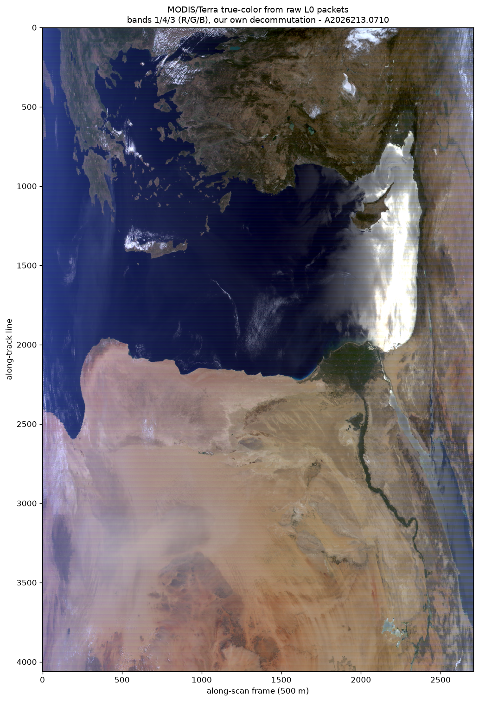
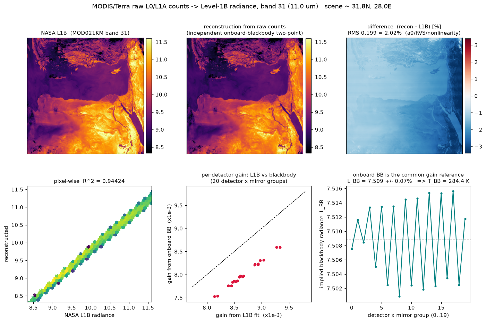
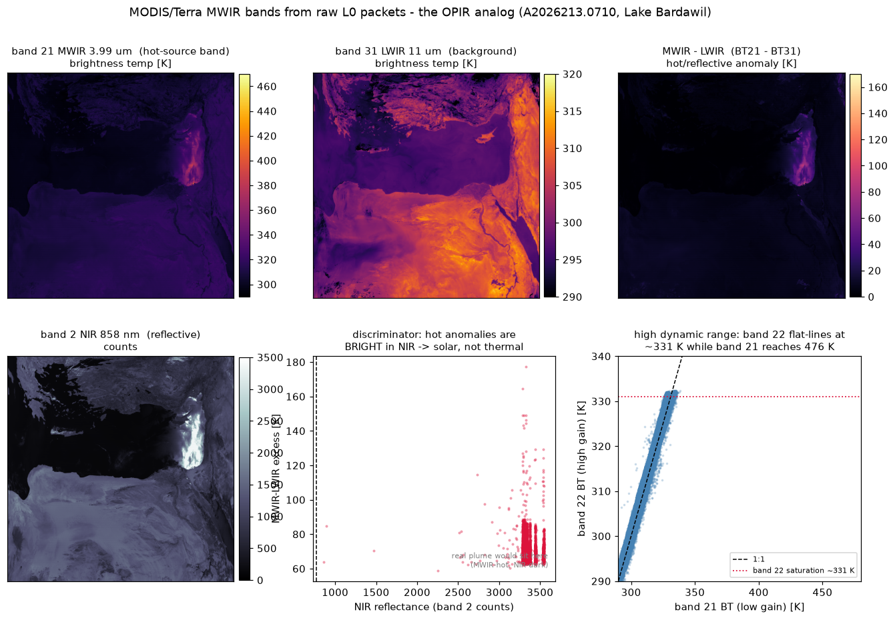

# MODIS L0 → L1B: raw instrument packets → calibrated radiance, from scratch

The thermal-IR analog of the [CPHD → SICD](README.md) exercise. Umbra publishes the
raw phase history *and* the focused image for one SAR collect; NASA publishes the raw
MODIS instrument packets (**Level‑0**, `MOD00F`) *and* the calibrated radiance
(**Level‑1B**, `MOD021KM`) for one overpass. So the same challenge applies: with no
proprietary tools, start from the rawest data and reproduce the official product.

Everything here is **our own code** — a Python re‑implementation of the MODIS `MOD_PR01`
unpack plus an independent radiometric calibration. The only NASA binaries involved are
the *reference products we validate against*, never the answer.

## The collect

`MOD00F / MOD01 / MOD021KM / MOD03 . A2026213.0710` — Terra, **2026‑08‑01 07:10 UTC**,
daytime over the eastern Sahara / N. Egypt (~31.8 °N, 28 °E; clear desert → clean, high
thermal signal). Band **31** (11 µm, the clean atmospheric window). 203 scans × 10
detectors × 1354 frames.

| product | level | what it is | role |
|---|---|---|---|
| `MOD00F` | **L0** | raw CCSDS instrument packets (384 MB, 618 208 pkts) | **input** |
| `MOD01`  | L1A | decommutated counts (lossless repack of L0) | validate the unpack |
| `MOD021KM` | **L1B** | calibrated radiance | reference for the calibration |
| `MOD03` | geo | geolocation | mapping |

Raw MODIS counts only exist as archived L0 (`MOD00F`) or NRT L1A (`MOD01`); both are
LANCE/NRT‑only, fetched from `nrt3.modaps.eosdis.nasa.gov` with an Earthdata token after
accepting the LANCE license.

## Pipeline

```
MOD00F (raw CCSDS packets)
   │  src/modis/modis_l0_decom.py   — our MOD_PR01 unpack (bit-exact vs MOD01)
   ▼
detector counts  (EV 10×1354, + onboard BB 10×50, SV 10×50 per scan)
   │  src/modis/modis_l1b_recon.py  — onboard-blackbody two-point radiometry
   ▼
radiance  ──────────────  compare  ──────────────►  MOD021KM (NASA L1B)
```

### 1. Decommutation (L0 → counts) — `src/modis/modis_l0_decom.py`

The hard part. MODIS packs 12‑bit samples in a non‑obvious interleave that is **not**
publicly documented in prose — but the open‑source SDST/OCSSW `l1agen_modis` C code
*is* the spec. Ported to Python and pinned by direct byte inspection:

- 618 208 packets, all APID 64, fixed 642 B; 6 B CCSDS primary + 8 B timestamp
  (decodes to 07:10:00 UTC) + 4 B MODIS header + science from **byte 18**.
- 12‑bit samples, 2 per 3 bytes, big‑endian (`unpack_packet_contents.c`).
- day packet = 415 samples = **5 IFOVs × 83**; per IFOV: 250 m → 500 m → 1 km‑day(14)
  → 1 km‑night(17). A 1 km‑night band sits at word `ifov·83 + 66 + (band−20)`.
- **detectors are reversed**: `line = 9 − scan_ifov` (this was the non‑obvious bit).
- `earth_frame_cnt`/`cal_frame_cnt`/`cal_type` decoded from header bits; **EV is
  downlinked before the cal sectors**, and a block's cal belongs to the *next* block's
  Earth view, so `EV(scan s)=block s+1`, `BB/SV(scan s)=block s` tail.

**Validation — bit‑exact vs NASA's official L1A over the whole granule**, every
resolution path (250 m / 500 m / 1 km, Earth view + onboard calibrators):

| array | resolution | samples | mismatches |
|---|---|---|---|
| EV band 31 (11 µm) | 1 km | 2 748 620 | **0** |
| BB band 31 | 1 km | 101 500 | **0** |
| SV band 31 | 1 km | 101 500 | **0** |
| EV band 1 (red) | 250 m | 43 977 920 | **0** |
| EV band 4 (green) | 500 m | 10 994 480 | **0** |
| EV band 3 (blue) | 500 m | 10 994 480 | **0** |

Because the 250 m/500 m paths work too, we get **true‑color straight from L0**
([out/modis_l0_truecolor.png](out/modis_l0_truecolor.png)) — bands 1/4/3 composited,
Nile Delta and eastern Mediterranean and all:



### 2. Calibration (counts → radiance) — `src/modis_l1b_recon.py`

Thermal emissive bands: each scan views cold space (SV, ~0 radiance) and the onboard
blackbody (BB, ~290 K). Two known points → per‑detector gain, applied to the Earth view.
Textbook two‑point radiometry — the calibration reference is *in the raw data*.

## Results (band 31, vs `MOD021KM`)

The figure shows the **independent** reconstruction (top-middle) against NASA's L1B
(top-left); the difference (top-right) is the honest 2 % residual — the systematic
`a0` offset plus the RVS banding.



| reconstruction | RMS vs NASA L1B | R² | independence |
|---|---|---|---|
| **independent, blackbody‑referenced** *(shown in figure)* | **0.20 = 2.0 %** | 0.944 | gain from the onboard BB counts — **nothing taken from L1B** |
| per‑detector affine (gain+offset) | 0.048 = 0.49 % | 0.9967 | coefficients *fit to L1B* — a recovery, not a blind reconstruction |
| + RVS (scan‑angle) | 0.023 = 0.23 % | 0.9993 | RVS also *fit to L1B* — shows the residual is exactly a0/RVS/nonlinearity |

The honest headline: our from‑scratch L1B reproduces NASA's to **~2 %**. The 0.49 %/0.23 %
rows borrow coefficients from the L1B they're compared against, so they measure "is L1B a
linear map of our counts" (yes, to sub‑%), not a blind reconstruction — kept labeled as such.

- **The onboard blackbody is the common gain reference — proven from the data:** the
  implied BB radiance `L_BB = a0 + b1·dn*_BB`, computed independently for all **20
  (detector × mirror‑side) groups**, agrees to **0.07 %** (7.509 ± 0.005). Twenty
  independent calibrations see the same blackbody.
- **The residual is the "proprietary chain," quantified.** The 2.0 % (independent) vs
  0.49 % (affine) gap is MODIS's self‑emission offset `a0`; the vertical banding in the
  difference map is response‑vs‑scan‑angle (RVS); the derived **T_BB ≈ 284 K** vs the
  operational ~290 K is the omitted quadratic nonlinearity (it biases `L_BB` low). Same
  signature as the SAR ~0.77 SICD coherence gap: textbook algorithm reproduces the
  product to a few percent, the rest is the provider's exact interpolation/shaping.

## The OPIR analog — MWIR bands 20–25 ([src/modis_opir_mwir.py](src/modis_opir_mwir.py))

This project started from a question about **OPIR** (Overhead Persistent Infrared —
missile-warning sensors that detect hot rocket plumes by their mid-wave IR emission).
Real OPIR data is classified; MODIS bands **20–25 (3.7–4.5 µm MWIR)** are the open
spectral analog — band 21 is the low-gain hot-source band (saturates ~500 K), band 22
its high-gain twin (~331 K), bands 24/25 sit in the 4.4 µm CO₂ feature OPIR uses. All
six calibrate from L0 bit-exact to <0.5 %.



Running the OPIR job on this granule — **detect MWIR hot anomalies, then reject false
alarms** — surfaces a textbook case:

- **Detection:** band 21 hits **476 K** where band 31 (LWIR) reads a flat **300 K** — a
  176 K MWIR-over-LWIR excess. The Planck curve swings toward short wavelengths when
  something is hot/bright, so MWIR sees what LWIR can't. Band 22 (high gain) **saturates**
  at the peak; the low-gain band 21 is what keeps measuring — the same high-dynamic-range
  design OPIR needs.
- **Discrimination:** all 3934 anomalies are over the Mediterranean at Lake Bardawil, and
  **100 % are also bright in the NIR** (band 2 = 3327 vs 160 counts) → they are **reflected
  sunlight** (glint / hyper-bright salt flats), not thermal sources. A real plume emits, so
  it is MWIR-hot but **NIR-dark**; this scene has **zero** MWIR-hot / NIR-dark pixels. That
  NIR test is exactly the plume-vs-glint filter an OPIR chain must apply.

Same technique as a real OPIR L0→L1B: raw counts → onboard-calibrator radiometry →
brightness temperature → hot-source detection with false-alarm rejection.

## Files

| file | role |
|---|---|
| `src/modis_l0_decom.py` | **our MOD_PR01 unpack** — CCSDS parse + 12‑bit de‑interleave, L0 → counts (1 km + 250 m/500 m), bit‑exact vs MOD01 |
| `src/modis_l1b_recon.py` | onboard‑blackbody TEB calibration + RVS, counts → radiance, compare to L1B, figure |
| `src/modis_l0_truecolor.py` | true‑color RGB (bands 1/4/3) straight from L0 |
| `src/modis_opir_mwir.py` | MWIR bands 20–25 (OPIR analog): BT, hot‑source detection, solar‑vs‑thermal discrimination |
| `src/run_l0_to_l1b.py` | end‑to‑end driver: L0 → counts → radiance → compare |
| `tools/l1agen_src/*.c,*.h` | the open‑source SDST/OCSSW reference the interleave was ported from |

## Run

```bash
# env with pyhdf (HDF4) — MODIS L1A/L1B are HDF-EOS2
micromamba create -p .mamba/modis -c conda-forge python=3.11 pyhdf numpy scipy matplotlib h5py

# fetch the granule dataset (needs an Earthdata token in ~/.edl_token or EARTHDATA_TOKEN)
./download_modis_data.sh ./data/modis   # or: bash data/modis/fetch.sh

# validate the unpack, then run L0 -> L1B
PYTHONPATH=src/modis micromamba run -p .mamba/modis python src/modis/modis_l0_decom.py \
    --l0 data/modis/MOD00F.*.001.NRT --l1a data/modis/MOD01.*.hdf --band 31
PYTHONPATH=src/modis micromamba run -p .mamba/modis python src/modis/run_l0_to_l1b.py \
    --l0 data/modis/MOD00F.*.001.NRT --l1b data/modis/MOD021KM.*.hdf \
    --l1a data/modis/MOD01.*.hdf --geo data/modis/MOD03.*.hdf --band 31
```

## Why MODIS (and not VIIRS) for the raw case

MODIS applies **no onboard non‑uniformity correction and no onboard spatial
aggregation** — the L0 counts are the pristine per‑detector readout, and all
NUC/calibration is a ground step (which is why L1B still shows detector striping).
VIIRS irreversibly aggregates and bow‑tie‑deletes onboard before downlink, so its
"raw" is already processed. MODIS is the clean L0 → L1B analog of the SAR work.
