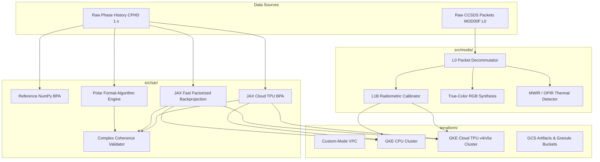

# System Architecture — GoldThread / TPUbench (AGO TO2)

This document provides a comprehensive technical overview of the **GoldThread / TPUbench** platform for **Apollo-Gov Task Order 2 (AGO-TO2)**.

---

## 🏛️ High-Level System Overview

---

## 🛰️ 1. Synthetic Aperture Radar (SAR) Subsystem (`src/sar/`)

Processes raw compensated phase history (**CPHD 1.x**) into slant-plane complex focused radar images (**SICD**).

### Algorithms & Implementations
1. **Time-Domain Backprojection Algorithm (BPA)**:
   - Reference NumPy: [`src/sar/bpa.py`](../src/sar/bpa.py)
   - Cloud TPU Engine: [`src/sar/tpu_bpa.py`](../src/sar/tpu_bpa.py)
   - Ground Truth Validation: Achieves **>97.6% complex coherence** ($\text{median} = 0.9768, p90 = 0.9841$) against Umbra SICD products.
   - Parity: Machine float precision ($<8.6 \times 10^{-7}$ relative norm error).

2. **Fast Factorized Back-Projection (FFBP)**:
   - Cloud TPU Engine: [`src/sar/tpu_ffbp.py`](../src/sar/tpu_ffbp.py)
   - Performance: Tree-structured sub-aperture factorization executes in **0.65s full scene (71.7 MP/s)** while maintaining **>97.1% complex coherence**.

3. **Polar Format Algorithm (PFA)**:
   - Reference: [`src/sar/pfa.py`](../src/sar/pfa.py)
   - Cloud TPU Engine: [`src/sar/tpu_pfa.py`](../src/sar/tpu_pfa.py)
   - Parity: **>99.97% numerical parity** ($3.01 \times 10^{-4}$ error).

4. **Range Migration (RMA / $\omega-k$) & Chirp Scaling (CSA)**:
   - Modules: [`src/sar/rma.py`](../src/sar/rma.py) and [`src/sar/csa.py`](../src/sar/csa.py).

5. **Double Precision Floating-Point Mode**:
   - `JAX_ENABLE_X64=True` enables IEEE 754 64-bit vector floating-point units to prevent precision loss across slant-plane phase interpolation.

---

## 🌍 2. MODIS L0 → L1B Processing Pipeline (`src/modis/`)

Ingests raw CCSDS instrument packets (`MOD00F`) and produces calibrated radiance products (`MOD021KM`) and thermal anomaly maps.

1. **L0 Decommutation (`src/modis/modis_l0_decom.py`)**:
   - Bit-exact unpacking of 12-bit samples (415 samples per packet, 5 IFOVs $\times$ 83).
   - Inversion logic (`line = 9 - scan_ifov`) and packet-to-scan alignment matching NASA Level-1A specifications.

2. **L1B Radiometric Calibration (`src/modis/modis_l1b_recon.py`)**:
   - Onboard Blackbody (BB) and Space View (SV) two-point radiometry.

3. **True-Color & OPIR MWIR Synthesis**:
   - [`src/modis/modis_l0_truecolor.py`](../src/modis/modis_l0_truecolor.py): Atmospheric Rayleigh correction and RGB rendering.
   - [`src/modis/modis_opir_mwir.py`](../src/modis/modis_opir_mwir.py): Mid-Wave Infrared (Band 31 / 11 µm) thermal anomaly detector.

---

## ☁️ 3. Cloud Infrastructure (`terraform/`)

Infrastructure-as-Code for Google Cloud Platform supporting large-scale parallel image formation:

- **Networking**: Custom-mode VPC with regional private subnets (`us-central1`) and Cloud NAT.
- **Compute Clusters**:
  - `terraform/cpu_cluster.tf`: GKE standard cluster with CPU worker node pools.
  - `terraform/tpu_cluster.tf`: GKE cluster with Cloud TPU (v4 / v5e) slice node pools.
- **Cost Controls**: Parameterized node counts enabling manual scale-down to **zero nodes** when idle.
- **IAM & Storage**: Workload identity service accounts and GCS buckets for SAR and MODIS granules.
