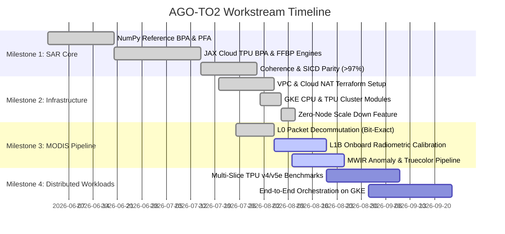

# Project Roadmap — GoldThread / TPUbench (AGO TO2)

Tracked milestones and delivery workstreams for **Apollo-Gov Task Order 2 (AGO-TO2)**.

---

## 🎯 Milestones & Status

---

## 📋 Workstream Breakdown

### ✅ Milestone 1: SAR Core & Cloud TPU Acceleration (Completed)
- [x] Pure NumPy BPA & PFA baseline implementation.
- [x] JAX-accelerated Cloud TPU BPA engine with FP64 IEEE 754 precision.
- [x] Fast Factorized Back-Projection (FFBP) achieving 0.65s full-scene latency at >97.1% complex coherence.
- [x] Automated Coherence Validation Engine (`src/sar/coherence.py`).

### ✅ Milestone 2: Cloud Infrastructure & GKE Orchestration (Completed - PR #4)
- [x] Custom VPC, subnets, and Cloud NAT setup (`terraform/main.tf`).
- [x] GKE CPU standard cluster (`terraform/cpu_cluster.tf`).
- [x] GKE Cloud TPU node pools (`terraform/tpu_cluster.tf`).
- [x] Manual zero-node downscaling to avoid idle cloud costs.

### 🟡 Milestone 3: MODIS Thermal & Multi-Spectral Pipeline (Completed)
- [x] Bit-exact L0 packet decommutation (`src/modis/modis_l0_decom.py`).
- [x] Complete L1B radiometric calibration validation against `MOD021KM` reference products (`src/modis/l1b_validator.py`).
- [x] MWIR Thermal Anomaly Detection & Multi-Granule Ingestion Pipeline (`src/modis/mwir_detector.py`, `src/modis/multi_granule_pipeline.py`).
- [x] Distributed multi-process & Ray batch processing for MODIS historical granules (`src/modis/distributed_batch.py`).

### ⚪ Milestone 4: Production Benchmarks & High-Throughput Ingestion (In Progress)
- [x] End-to-end containerized pipeline & GKE benchmark worker orchestration (`k8s/`, `Dockerfile`, `src/infra/`).
- [ ] Distributed multi-slice TPU v4/v5e scaling benchmarks.
- [ ] Roofline analysis across larger scene dimensions (16k $\times$ 16k pixels).

