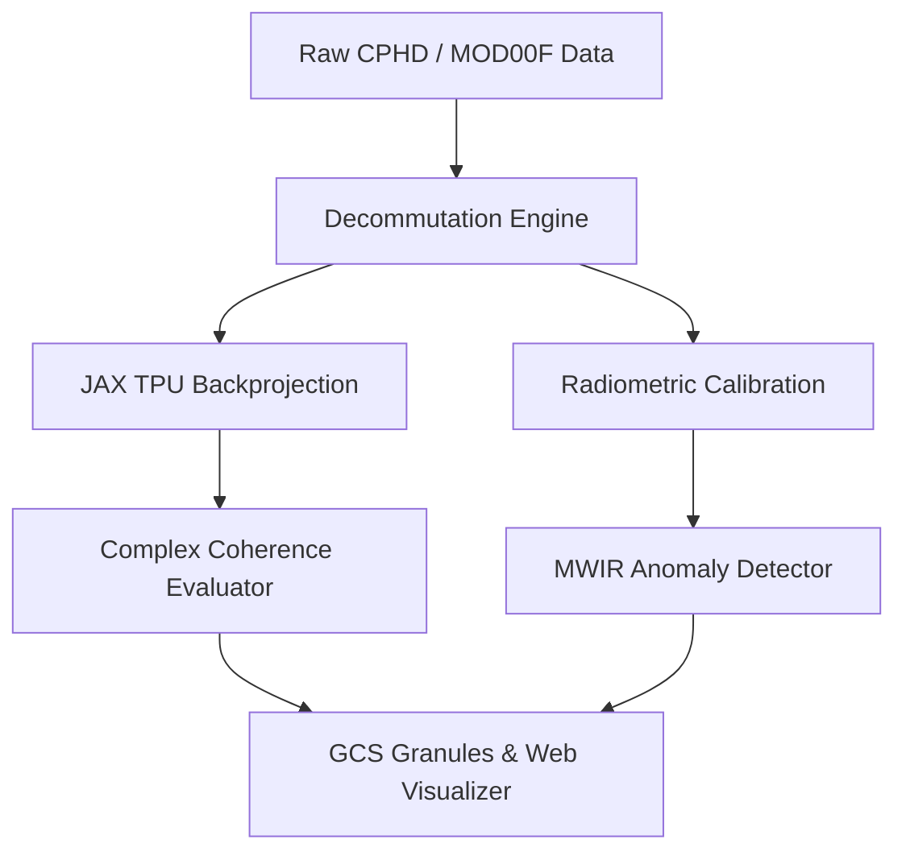

# GoldThread / TPUbench System Architecture Spine

> **Last Updated:** 2026-08-17  
> **Status:** Active Reference

## 1. Architectural Invariants
- **AD-1 (JAX Functional Purity)**: Core signal processing routines are implemented as pure, JIT-compilable JAX functions suitable for Cloud TPU execution.
- **AD-2 (Telemetry Hermeticity)**: Telemetry bitfield unpacking and radiometric calibrators operate deterministically from local granule buffers.
- **AD-3 (Complex Coherence Validation)**: All SAR focusing output is validated against Umbra ground truth using complex cross-correlation.
- **AD-4 (GKE Job Orchestration)**: Heavy batch processing is distributed across GKE worker node pools via headless batch jobs.

## 2. Microservice & Pipeline Diagram

